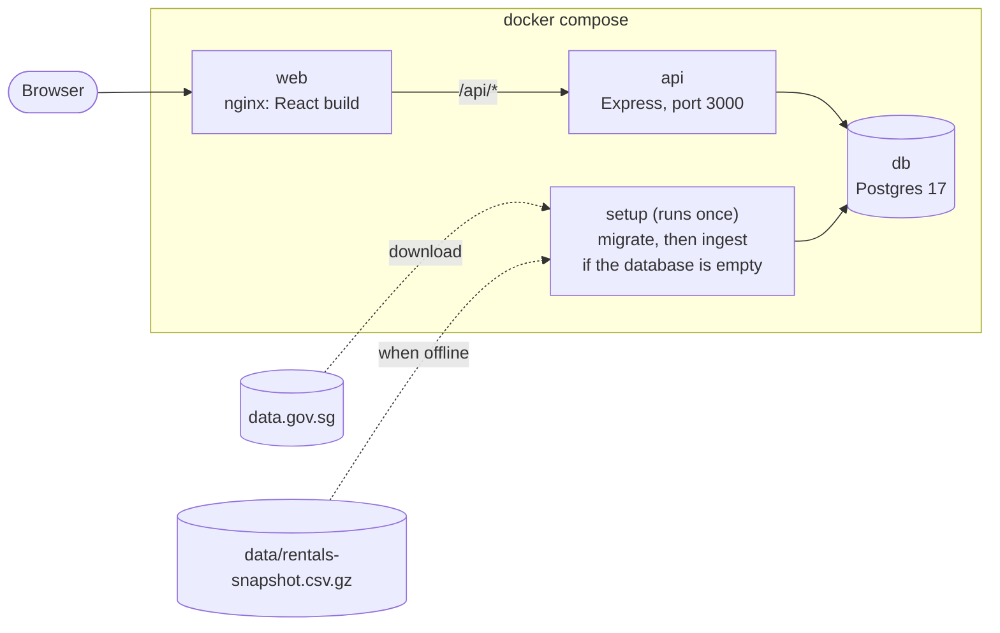
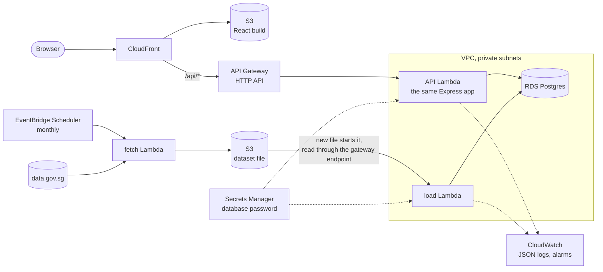

# RentLens design

RentLens helps a tenant answer one question: "I can pay S$X a month for an N-room HDB flat. Where can I live?" It ranks streets by how many recent rents fall within the budget, shows the same on a map of Singapore, and checks whether a listing's rent is usual for its street.

This document explains the data, the rules the app applies to it, the architecture, and the reason for each technical choice.

## 1. Product

**User:** a tenant who wants to rent a whole HDB flat and has a monthly budget. The rent check also works for a landlord asking "what can I charge?".

**Questions it answers:**

1. "Where can I rent on my budget?" The budget page: a slider, a flat type, an optional town, a ranked list of streets and a map.
2. "Is this listing's rent fair?" The street page: quartiles, a quarterly trend against all of Singapore, and a rent check.

**Out of scope:** rent against buy (the HDB resale dataset), statistics per block, saved searches and user accounts.

## 2. Data

Source: HDB "Renting Out of Flats from Jan 2021", data.gov.sg dataset `d_c9f57187485a850908655db0e8cfe651`, about 212,600 rows from Jan 2021. Columns: `rent_approval_date` (YYYY-MM), `town`, `block`, `street_name`, `flat_type`, `monthly_rent`. One row is one approval to rent out a whole flat. Owners declare the rent; HDB does not check it.

Map boundaries: URA Master Plan 2025 Planning Area Boundary (No Sea), data.gov.sg dataset `d_2cc750190544007400b2cfd5d7f53209`.

### What the data showed

Measured on the real file, 4-room flats, 12 months from Oct 2025 to Sep 2026 (13,475 rentals):

| Finding | Number | Decision |
|---|---|---|
| Rentals per block and flat type | median 2; only 2,255 of 12,369 groups have 5 or more | No statistics per block |
| Rentals per street and flat type | median 12; 986 of 1,742 groups have 10 or more | The street is the smallest unit; groups under 10 are "low data" |
| Round-number rents | on Yishun Ring Rd, 29 of 138 rents are exactly S$3,000; many street medians are exactly S$3,000 | Rank streets by the **share of rents at or below the budget**, not by median, because medians tie everywhere |
| Monthly street medians | 5 to 24 rentals a month, noisy | The street trend is **quarterly** |
| Rent range | S$300 to S$9,200; 60 rents under S$1,500 | Keep every valid row; percentiles are not moved by a few outliers |
| Flat type spelling | `4-ROOM` here, `4 ROOM` in the resale data | One `normalizeFlatType` function in the shared package |
| Towns and planning areas | HDB towns do not match URA planning areas one to one | A join table, `TOWN_PLANNING_AREAS`: Kallang/Whampoa covers Kallang and Novena; Central covers Outram and Rochor |
| Publication delay | on 31 Oct 2026 the newest month was Sep 2026 | The window ends at the newest month in the data, not at today's date |

HDB's own rental statistics page also hides town medians when a town and flat type has fewer than 20 approvals in a quarter.

### Rules

- **Window:** the latest 12 months in the data, inclusive (`WINDOW_MONTHS`).
- **Share within budget:** rentals with `monthly_rent <= budget`, divided by all rentals in the group.
- **A street fits** when its share is at least 0.5 (`FIT_SHARE`). Cards show the share as "N in 10", rounded down, so a card never says "5 in 10" for a street the headline does not count. A share above 0 but under 0.1 shows as "Under 1 in 10".
- **Low data:** fewer than 10 rentals (`MIN_RENTALS`). These streets are hidden by default. A checkbox shows them, tagged, after every street with enough rentals, so a street with 1 rental at 100% cannot top the list.
- **Rent check verdict:** below the 25th percentile is "below most rents", above the 75th is "above most rents", and anything else is "in the usual range". The check compares with the street. If the street is low data, it compares with the whole town and says so. If the town is also low data, the page calls the verdict a rough guide.
- **Trend:** 8 quarters, ending at the last complete quarter. With data up to October, the newest point is Q3, not a Q4 that holds one month. A quarter with fewer than 3 rentals on the street is a gap in the line.
- **Map colours:** five fixed steps of the share (under 10%, 10 to 24%, 25 to 49%, 50 to 74%, 75% or more), from the same rounded percent the labels show. A colour means the same share in every view. When every town lands in the lowest or highest step, a note says so and suggests another budget. "Top towns" breaks ties by number of rentals.
- **Budget slider:** S$1,000 to S$6,000 in S$100 steps. The API accepts S$300 to S$10,000. A budget in the URL is rounded to the step and kept inside the slider range, so the label, the slider and the request always agree.

## 3. Architecture

### Local

`docker compose up --build`, then open http://localhost:8080.



### AWS deployment design



The handlers are plain functions over a small `Db` interface (`query`, `exec`, `transaction`). Express calls them locally, the tests call them through Express with PGlite, and on AWS the same Express app runs in Lambda through the AWS Lambda Web Adapter.

### Repo layout

```
packages/shared   types, zod query schemas, constants, flat type and town helpers
apps/api          Express API, migrations, ingest job, tests
apps/web          React app, map data, tests
data/             gzipped dataset snapshot, used when data.gov.sg cannot be reached
docs/             this file
infra/            Terraform for the AWS deployment
```

### AWS choices

- **Lambda and API Gateway, not ECS Fargate and a load balancer.** Lambda and API Gateway charge per request and per unit of run time, so a low-traffic app costs little when idle. A Fargate task and an Application Load Balancer both charge for every hour they run, whether or not requests arrive. The cost of Lambda is cold starts: the first request to a new instance waits while it starts. CloudFront caches most GET responses, so few requests reach a cold instance.
- **Database connections:** reserved concurrency of about 10 on the API Lambda and a pool of 1 to 2 per instance, so Postgres sees at most about 20 connections. No RDS Proxy at this traffic.
- **Postgres settings:** `jit=off` and `statement_timeout` go in the RDS parameter group.
- **Rate limiting:** API Gateway throttling. The in-memory limiter in the API counts per instance, so it only protects the local setup.
- **Monthly ingest in two steps:** EventBridge Scheduler starts a "fetch" Lambda outside the VPC, which downloads from data.gov.sg into S3. The new file starts a "load" Lambda inside the VPC, which reads it through a gateway endpoint and loads Postgres. This avoids a NAT gateway, which charges for every hour it runs and for every GB it processes. The load Lambda has a concurrency of 1, and the table lock still guards against overlapping loads.
- **Secrets:** RDS creates the master password and keeps it in Secrets Manager. Terraform also creates one empty secret per login role and gives each Lambda read access to its own only: the API reads the `rentlens_api` secret and the load Lambda the `rentlens_ingest` one. No Lambda can read the master password, and no password enters Terraform state. The Lambdas read their secret through an interface endpoint.
- **First deploy:** a one-time provisioning step, run with the master password, applies the migrations, generates a password for each login role, stores it in that role's secret, and runs the `roles` command with it.
- **Monitoring:** CloudWatch alarms on API 5xx responses, on a failed fetch or load (a failed monthly ingest otherwise goes unnoticed, because last month's data stays in place), and on database storage and CPU, sent to an SNS topic.

The Terraform is in `infra/`. It has not been applied to an AWS account, so CI checks it in three ways on every pull request:

- `terraform validate`: the configuration is complete and well formed.
- `terraform test` with a mocked AWS provider (`infra/tests/main.tftest.hcl`): Terraform builds the plan and applies it to fake resources, then checks the properties that matter. The database is private, encrypted, keeps its password in Secrets Manager and has backups; Postgres accepts only the Lambdas' security group; `jit` is off; the private subnets have no route out; the API and load Lambdas are in the VPC and the fetch Lambda is not; concurrency is capped; both buckets block public access; CloudFront redirects to HTTPS and sends the Content Security Policy; API Gateway throttles; both ingest steps have alarms. Breaking any of these on purpose fails the test.
- A Trivy configuration scan, failing on HIGH and CRITICAL findings. The accepted findings and their reasons are in `infra/.trivyignore`: the buckets and the alarm topic use AWS-managed encryption keys instead of customer-managed KMS keys, and there is no WAF.

These prove the configuration says what the design says. They do not prove it deploys: only a `terraform apply` to an account does that.

## 4. API

All routes are `GET` and return JSON. Inputs are checked with zod (400 with field errors). Responses carry `Cache-Control: public, max-age=300` and `x-request-id`. Rate limit: 120 requests a minute per IP.

| Endpoint | Returns |
|---|---|
| `/api/v1/meta` | window, row count, load time, source |
| `/api/v1/towns?flatType&budget` | per town: rentals, rentals within budget, share, low data |
| `/api/v1/streets?flatType&budget&town&includeLowData&page&pageSize` | ranked streets with quartiles, plus the number that fit, the number with low data, and the total |
| `/api/v1/streets/detail?flatType&town&street` | quartiles, town median, blocks, histogram, 8-quarter trend against Singapore |
| `/api/v1/rent-check?flatType&town&street&rent` | share lower, share equal, quartiles, verdict, and whether it compared with the street or the town |
| `/healthz` | database ping |

Routes are versioned under `/api/v1`, so a breaking change can ship as `/api/v2` while old clients keep working. `/healthz` is for infrastructure and is not versioned.

Errors are all `{ "error": "..." }` JSON: 400 with field errors, 404 for an unknown street or route (including `/api/...` without the version), 429 over the rate limit, 503 before any data is loaded or when Postgres cannot be reached, and 500 with no internal detail.

Timeouts on the API's connection pool: 10 s `statement_timeout` on the server, 15 s `query_timeout` on the client (for a dead network path), and 5 s to connect. The ingest job has no statement timeout.

## 5. Technical decisions

Stack, with the short reason for each:

- **React 19, Vite, TypeScript:** no login and no search-engine need, so a static build is enough and no server-rendering framework is needed.
- **Tailwind v4:** styles sit next to the markup, and theme tokens keep colours and sizes consistent.
- **TanStack Query:** caching, loading and error states, and cancelling stale requests while the slider moves, without hand-written `useEffect` code.
- **Node and Express 5:** one language end to end, and the most widely known Node HTTP framework.
- **zod in a shared package:** the API and the web app check requests with the same schemas and types.
- **pino and helmet:** JSON logs with request IDs, ready for CloudWatch; standard security headers in one line.
- **Postgres 17:** the queries are percentiles and grouped counts, which SQL does well; RDS runs it on AWS.
- **Yarn 4 workspaces:** one repo for the shared package, API and web app, with a pinned Yarn version and a 24-hour package age gate.
- **TypeScript 7:** the Go compiler type-checks each workspace in about 0.1 s.
- **Biome:** one tool for lint, format, import order and Tailwind class order.
- **esbuild for the API:** one file per entry point, which is also what a Lambda ships.

The choices below are the ones a reader might question.

| Choice | Why | Instead of |
|---|---|---|
| All search state in the URL | results can be shared and bookmarked | component state |
| Map as SVG from data.gov.sg boundaries (12 KB, built by `apps/web/scripts/build-map.mjs`) | no API key, no map tiles, works offline, real elements for labels and clicks | Leaflet or Mapbox |
| Charts as SVG written by hand | two small charts, with full control of the accessible text | a chart library |
| Postgres with SQL written by hand through `pg` | every query uses `percentile_cont`, `count(*) FILTER`, `LATERAL` or `json_agg`, which an ORM cannot express; the code shows the same SQL that `EXPLAIN` measured | Prisma or Drizzle (these queries would all be raw SQL); Kysely or pgtyped if checked result types were wanted |
| No materialized view | live queries take 3 to 8 ms (section 6) | precomputed quartiles |
| No DynamoDB | a key-value store has no aggregation, so percentiles would move into code | DynamoDB |
| No Redis | queries take under 10 ms and the data changes monthly; HTTP caching covers it | a Redis cache |
| Ingest replaces the table in one transaction, under `LOCK TABLE ... IN EXCLUSIVE MODE` | readers see the old data until the commit; a re-run gives the same result; the lock makes two overlapping loads run one after the other (without it, two loads left every row twice) | appending, or `TRUNCATE`, which blocks readers |
| Ingest checks | a row is rejected if its month is outside Jan 2021 to now or its rent is not whole dollars up to S$50,000; a load stops if over 1% of rows are rejected, if its data ends earlier than the loaded data, or if it has over 20% fewer rows (`--force` overrides the last two) | trusting the source |
| Bundled snapshot, used only when the database is empty | data.gov.sg limits bursts of requests, and the app must start on a machine without internet; once data is loaded, a failed download keeps it | always falling back |
| PGlite in tests | real Postgres in WebAssembly, so the real SQL and migrations run with no server | a mocked database |

## 6. Query performance

The streets query (4-room, S$3,000, 12-month window) on the full dataset, Postgres 17, `EXPLAIN (ANALYZE)`:

| Setup | Time | Plan |
|---|---|---|
| No indexes | about 35 ms | parallel sequential scan over 77,000 4-room rows |
| Covering index `(flat_type, approval_month) INCLUDE (town, street_name, monthly_rent)` | about 7 ms | index-only scan, 0 heap fetches after `VACUUM` |
| The same, with JIT on (the Postgres default) | about 100 to 140 ms | the percentile aggregates push the cost estimate over `jit_above_cost`, and JIT compiling takes about 100 ms for a 7 ms query |

So the API connects with `jit=off`, and the ingest runs `VACUUM ANALYZE` after each load, so the visibility map allows true index-only scans. The street trend query takes about 3 ms, and a rent check over HTTP about 3 ms.

## 7. Accessibility and security

- Real form controls with labels. The flat type is a radio group styled as pills. The slider has `aria-valuetext`, and its value sits outside the label, so it is read once.
- The map is an image with a text summary (`role="img"`). The "Top towns" list is the keyboard and screen-reader path to the same numbers.
- The results heading is a live region, and the rent check result is announced.
- Text colours pass WCAG AA. Form control borders are 3:1 or more (WCAG 1.4.11). Map labels switch between dark and white text by fill, and the map scale is one hue from light to dark, so it reads without colour vision. The rent-check bar for your rent has an outline and is named in the caption, not shown by colour alone.
- A skip link, visible focus outlines, and a layout that works at 390 px wide.
- axe-core runs in the component tests. Colour contrast is checked by hand, because jsdom cannot compute it.
- Database: the API logs in as `rentlens_api`, which can only `SELECT`. The ingest logs in as `rentlens_ingest`, which can replace the data and run `VACUUM` (Postgres 17's `MAINTAIN` privilege) but cannot change the schema. Only migrations use the owner. `migrations/002_roles.sql` creates the roles, and the `roles` command sets their passwords from the environment, quoted by Postgres itself with `format('%L')`.
- API: helmet headers, a GET-only CORS allow-list, a rate limit, zod checks, parameterised SQL only, no stack traces in responses, an incoming `x-request-id` accepted only as `[A-Za-z0-9-]{1,64}`, and control characters rejected in names.
- nginx (the local stand-in for CloudFront): a Content Security Policy, `X-Frame-Options: DENY`, `nosniff`, a one-year cache for hashed assets, `no-cache` on the app shell, and the API found through Docker DNS on each request.
- docker compose: Postgres and the API listen on 127.0.0.1 only, because the API trusts one proxy hop for `X-Forwarded-For`, which only nginx should send. Services restart on failure, and the web container starts after the API's health check passes.
- No login: the data is public and read-only, and the app stores nothing about users.

## 8. Tests

`corepack yarn test` runs Vitest in every workspace.

- `packages/shared`: flat type normalisation, display names, and the query schemas' coercion and limits.
- `apps/api`:
  - `parse.test.ts`: CSV parsing, each reject reason, the month range in Singapore time, whole-dollar rents.
  - `ingest.test.ts`: the snapshot is used only for an empty database, a re-run replaces instead of appends, the staleness and shrink checks and `--force`, the reject limit, and a failed `VACUUM` after the commit.
  - `api.test.ts`: every endpoint against a fixture whose numbers were worked out by hand (`test/fixtures/rentals.csv`, 40 rows with known percentiles, window edges, a bad row and a `4 ROOM` spelling).
  - `limits.test.ts`: rate limit, CORS, request IDs, a generic 500, and 503 when Postgres refuses connections.
  - `source.test.ts`: download retries. `stats.test.ts`: the histogram and the verdict.
  - `concurrency.test.ts`: two loads at once on a real Postgres keep one copy of the data. It runs only when `DATABASE_URL` is set, because PGlite has a single connection and cannot show the race.
- `apps/web`: formatting, the budget page (URL state, slider and checkbox requests, budget snapping, town filter, errors), the street page, the rent check, the API client's errors, the map (label sizes, selected-town outline, colour steps), the trend chart's gaps, and axe scans.

## 9. Known limitations

- Each handler reads the window and the statistics in separate statements, so a response that overlaps an ingest commit could mix the old window with new figures. It is rare (one load a month, 5-minute cache); a `REPEATABLE READ` transaction per request would remove it.
- The dataset download has no size limit. That is fine for a 10 MB file from data.gov.sg; add a byte limit if the source ever becomes untrusted.
- The rent check returns a town comparison for a street that does not exist, where the street page returns 404. The web app never sends such a request.
- The search replaces the browser history entry, so Back leaves the page instead of stepping through earlier searches. "Back to results" on the street page restores the full search.
- nginx answers some `/api/` errors itself, in HTML: 414 for a URL over 8 KB, 502 when the API is down, and a redirect for `/api` without the slash. The web client handles errors that are not JSON.
- A repeated query parameter (`budget=1&budget=2`) gets the right status, 400, but an unclear message.
- `?flatType=1-ROOM` loads 1-room results, but there is no 1-room choice in the UI (too few rentals), so no flat type is selected.

### Application code for AWS

- **Database connection** (`apps/api/src/db/connection.ts`): with `DATABASE_URL` set (local, Docker), nothing changes. On AWS the Lambdas get `DB_HOST`, `DB_NAME`, `DB_USER`, `DB_SECRET_ARN` and `DB_CA_PATH`: the password comes from the role's Secrets Manager secret at start-up, and the connection uses TLS checked against the RDS CA bundle, which RDS for Postgres 15 and later requires.
- **Ingest handlers** (`apps/api/src/lambda/`): "fetch" calls the existing `downloadDataset` and writes the file to S3; "load" reads the object named in the S3 notification and calls the existing `ingest`, with the same checks as a local load. Both take their dependencies as parameters, so the tests run them with fakes and PGlite.
- **Packages:** `corepack yarn workspace @rent-lens/api build:lambda` bundles each entry point with all its dependencies into one file and writes `build/api.zip` (`main.mjs`, `run.sh` for the Lambda Web Adapter, `rds-ca.pem`) and `build/ingest.zip` (`fetch.mjs`, `load.mjs`, `rds-ca.pem`), the paths the Terraform expects. CI builds both and checks that the bundles load with no `node_modules`.

### Not built yet for AWS

- **A first deploy:** nothing has been applied to an AWS account. The first deploy also runs the one-time provisioning step (migrations, then the role passwords).
- **Production hardening** (Trivy MEDIUM and LOW findings): CloudFront and S3 access logs, VPC flow logs, X-Ray tracing on the Lambdas, RDS IAM authentication, and a WAF in front of CloudFront.
